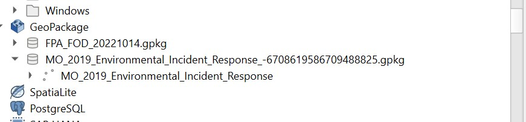
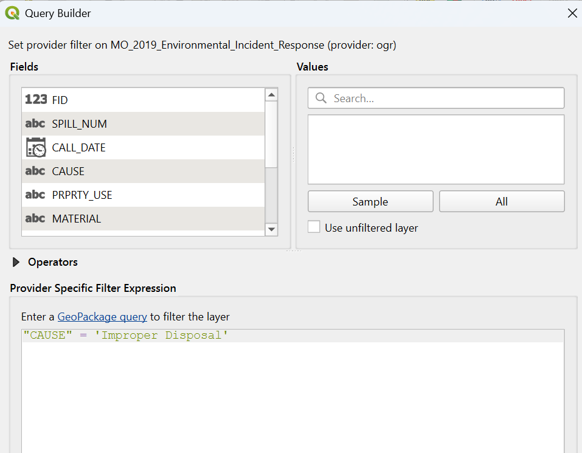
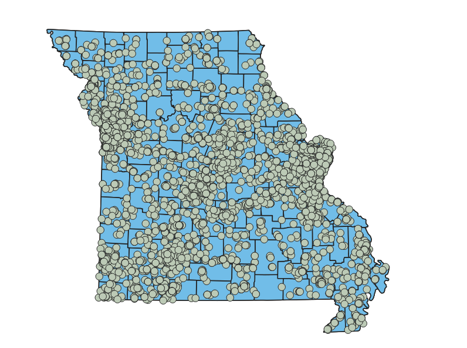
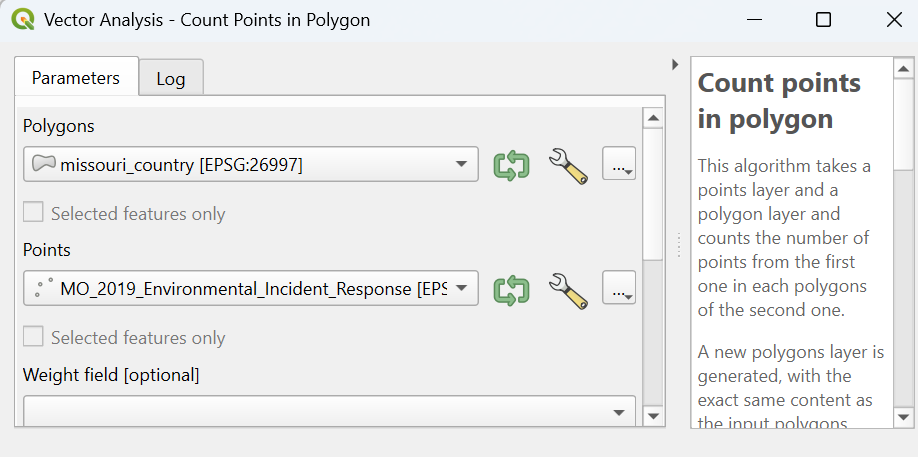
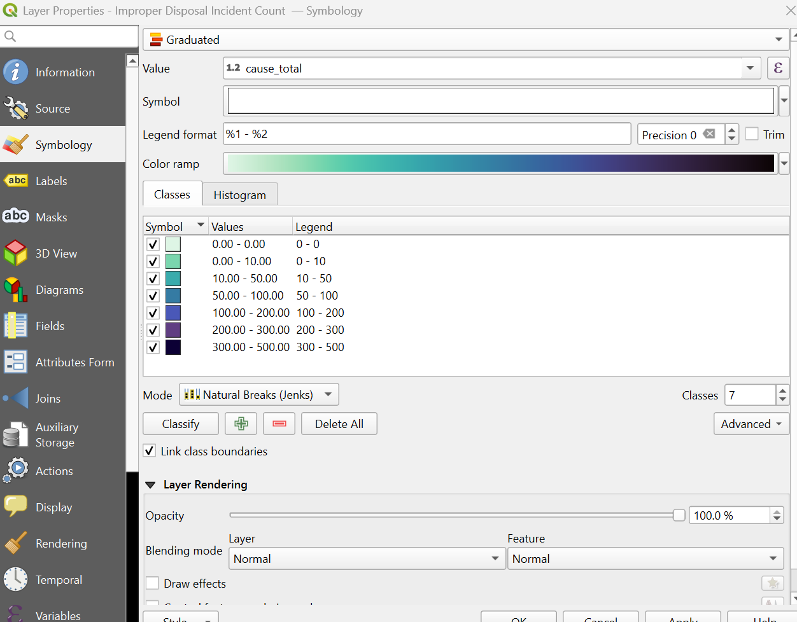
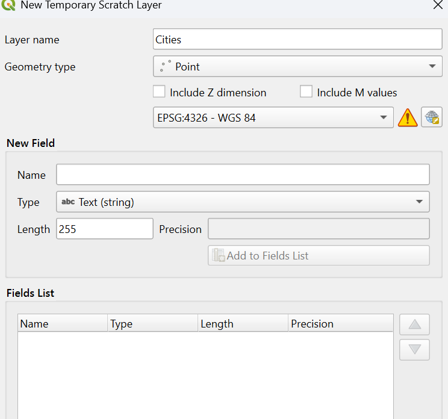

# Environmental Incidents In Missouri

This project was created to identify which counties in Missouri have had the most responses due to improper disposal, and what cities may be within those areas. It is imporant to understand which areas are most at risk to determine what level of regulation that may be required, lacking, or already sufficient. As someone that has to respond to some environmental issues, this map was a starting point to see what information is already available, and what may be helpful. 

# Accessing data files - Environmental Incident Response
Download the MO_2019_Environmental_Incident_Response as a GeoPackage, use the link below:
https://data-msdis.opendata.arcgis.com/search?q=incident

After downloading and adding the geopackage, select the MO_2019_Incident_Response, this is the data you will use

You will switch the projected coordinate system from EPSG:4326 and EPSG:26997, so the focus is Missouri. 

# Accessing data files - state and county data

Next download, then load the county and state layers in QGIS

[Missouri County.gpkg](data/missouri_county.gpkg)

[Missouri State.gpkg](<data/missouri state.gpkg>)

Source: U.S. Census Bureau TIGER Products

# Filter the Data 

Open a query builder for MO_2019_Incident_Response layer to Improper Disposal as the Cause

Map after filters

# Calculating Incident Count 

Find Count Points in Polygon in Processing Toolbox and enter parameters

# Save Output Layer as GeoPackage

Open the New layers Symbology Panel in Properties and Style the count data

# Adding Cities

Create a New Temporary Scratch Layer and create points on the map, and create lables within properties tab

Below is a shapefile that can be added to help determine citie boundries:
[City Boundry Shapefile](data/tl_2025_29_place.shp)

May have to go to source below and download then extract zip file before uploading to QGIS
Source:https://catalog.data.gov/dataset/tiger-line-shapefile-current-state-missouri-place

[View the index.html file](index.html)
